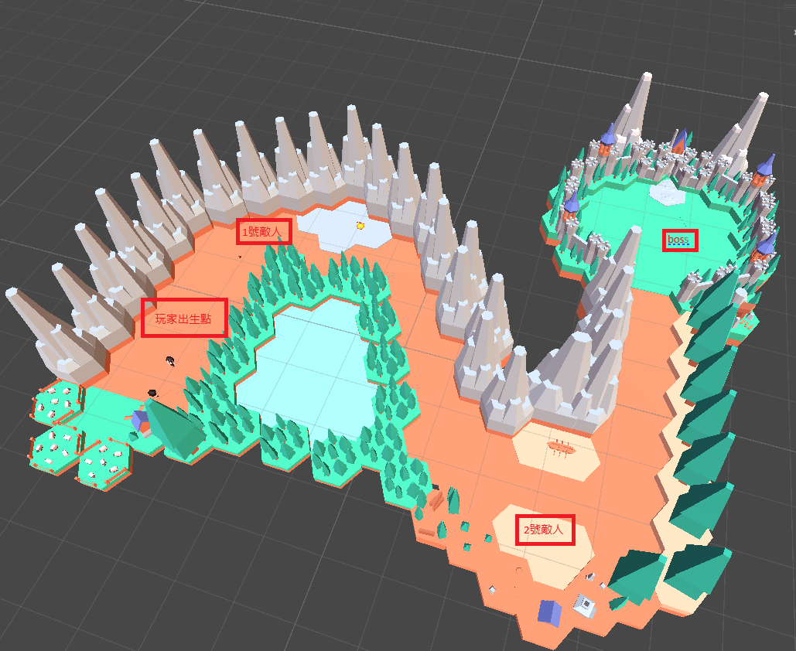
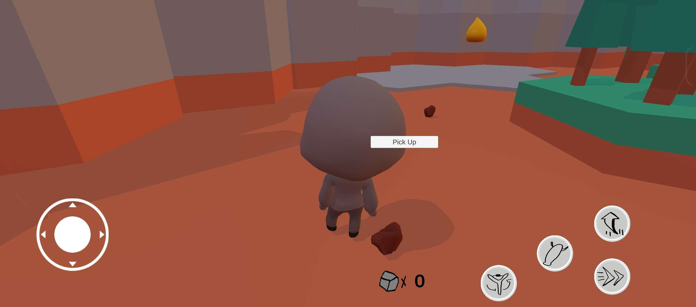
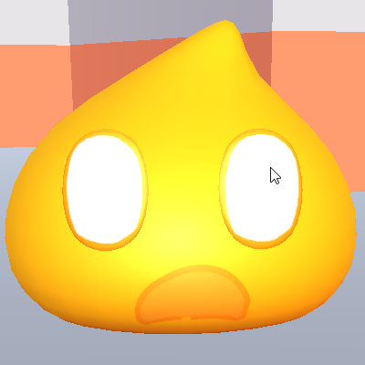
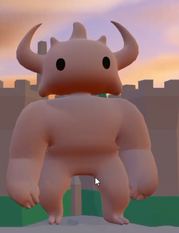
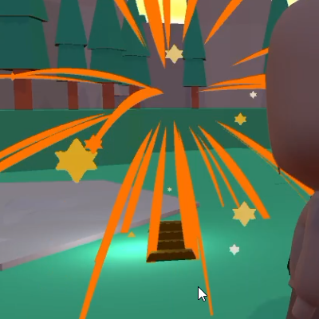

# Poor Adventure

- 使用 Unity 與 C# 開發的 3D 遊戲專案
- **由於未包含完整 Unity 專案及部分第三方資源，因此無法直接透過 Unity 開啟並執行完整遊戲**
>本 Repository 保存的是開發期間的 Unity 專案版本，並非最終發布版本，因為最終版本的完整原始專案因換電腦遺失且未能尋回。以下展示的影片、截圖均來自當時的最終版本，用來呈現最終成果

## 專案介紹
主角睡覺夢到一個npc跟他說獲得賺錢的機會，打完boos獲得獎勵

## 遊戲特色
### 場景互動
- 可以撿取散落在地面上的石頭
- 遠程攻擊因為時間因素未完成
### 戰鬥系統
- 玩家近距離攻擊可以連招
### 敵人與 Boss
- 遊戲包含兩種一般敵人
- 設計專屬 Boss 登場演出，增加遊戲過程中的情境感與戰鬥氣氛
- 擊敗 Boss 後可以獲得獎勵
## 遊玩畫面
### 遊戲場景

### 可撿拾的石頭

- 會在右下角顯示目前擁有的石頭數量
### 玩家戰鬥與連招影片

### 敵人展示
- 史萊姆:平常會巡邏，玩家靠近會變成攻擊模式，玩家跑遠會回到原點

- 敵人2號:玩家靠近才會產生，採用遠程攻擊，時間因素沒有材質
  

- boss:有特殊登場動畫，時間因素沒有材質，擊敗有獎勵
  

### Boss 登場影片

### 通關獎勵

### 快速通關影片
- 為了快速通關我調高玩家傷害
  

## 個人負責項目

- 使用 C# 開發遊戲邏輯與相關功能
- 設計及實作遊戲使用者介面（UI）
- 製作 3D 角色與敵人模型
- 製作敵人動畫
- 整合角色動畫與第三方素材

## 使用技術

- Unity
- C#
- blender

## 第三方素材與致謝

本專案開發過程中使用了以下第三方素材：

- **Fantasy Skybox FREE** — RK Render Knight  
  [Unity Asset Store](https://assetstore.unity.com/packages/2d/textures-materials/sky/fantasy-skybox-free-18353)

- **Joystick Pack** — FS Fenerax Studios  
  [Unity Asset Store](https://assetstore.unity.com/packages/tools/input-management/joystick-pack-107631)

- **Mixamo** — Adobe

以上素材均屬於原作者或發布者，使用時遵循各自的授權條款。本 Repository 不包含上述第三方素材的原始檔案。

## Repository 說明

本 Repository 作為 Poor Adventure 的作品集展示與開發紀錄，僅收錄經過篩選、確認可以公開的程式碼及專案素材。

**由於未包含完整 Unity 專案及部分第三方資源，因此無法直接透過 Unity 開啟並執行完整遊戲。**

## 專案狀態

已完成的學習專案，目前作為個人遊戲開發作品集與技術實作紀錄。
